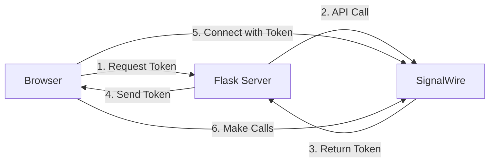

# Module 1: Foundation - Basic WebRTC Phone

## 🎯 Learning Objectives

By completing this module, you will:
- ✅ Understand WebRTC fundamentals and SignalWire's role
- ✅ Set up a basic Flask server for token generation
- ✅ Connect to SignalWire using JavaScript SDK
- ✅ Make outbound calls to phone numbers
- ✅ Handle basic call lifecycle events

## 📚 Prerequisites

- Basic knowledge of HTML, CSS, and JavaScript
- Python 3.7+ installed
- A SignalWire account with Call Fabric enabled
- A web browser with developer tools

## 🚀 Quick Start

1. **Install dependencies:**
   ```bash
   pip install -r requirements.txt
   ```

2. **Set up environment:**
   ```bash
   cp .env.example .env
   # Edit .env with your SignalWire credentials
   ```

3. **Run the application:**
   ```bash
   python app.py
   ```

4. **Open in browser:**
   ```
   http://localhost:3000
   ```

## 📂 Module Structure

```
module1-foundation/
├── app.py                 # Flask server (60 lines)
├── templates/
│   └── index.html        # Simple UI (240 lines)
├── static/
│   └── client.js         # WebRTC client (220 lines)
├── lessons/              # Learning materials
│   ├── 1.1-webrtc-basics.md
│   └── 1.2-signalwire-auth.md
└── lab/                  # Hands-on exercises
    └── instructions.md
```

## 🔑 Key Concepts Covered

### 1. Token-Based Authentication
- SignalWire uses JWT tokens for WebRTC authentication
- Tokens are generated server-side using your API credentials
- Each token identifies a specific subscriber (user)

### 2. WebRTC Connection Flow


### 3. Call Lifecycle
- **Initialization**: Create call object with destination
- **Ringing**: Call is being connected
- **Answered**: Remote party picked up
- **Active**: Call is in progress
- **Ending**: Call is terminating
- **Destroyed**: Call has ended, cleanup complete

## 💻 Code Walkthrough

### Server Side (app.py)
```python
# Key function: Token generation
def get_signalwire_token():
    # Fixed user 'user1' for simplicity
    payload = {'reference': 'user1'}
    # API call to SignalWire
    response = requests.post(url, json=payload, auth=credentials)
    return token
```

### Client Side (client.js)
```javascript
// Key steps:
// 1. Create client with token
client = await SignalWire.SignalWire({ token: TOKEN });

// 2. Go online
await client.online();

// 3. Make a call
call = await client.dial({ to: '/private/call-pstn', ... });
await call.start();
```

## 🧪 Testing Your Implementation

1. **Connection Test:**
   - Open browser console
   - Look for "✅ Connected to SignalWire!"
   - Connection indicator should turn green

2. **Call Test:**
   - Enter a valid phone number
   - Click "Start Call"
   - Watch console for state changes
   - Click "End Call" to hang up

## 🐛 Common Issues & Solutions

| Issue | Solution |
|-------|----------|
| "Failed to connect" | Check .env credentials are correct |
| Call button disabled | Wait for connection to establish |
| No audio | Check browser microphone permissions |
| Call fails immediately | Verify phone number format (+1XXXXXXXXXX) |

## 📊 What You've Built

- **Lines of Code**: ~520 total
- **Concepts**: 3 major (Auth, Connection, Calling)
- **Features**: 1 (Outbound calling)
- **Complexity**: ⭐ (Beginner)

## 🎓 Learning Exercises

### Exercise 1: Observe the Flow
1. Open browser developer tools
2. Go to Network tab
3. Reload the page
4. Watch the token request
5. Switch to Console tab
6. Make a call and observe logs

### Exercise 2: Modify the Default Number
1. Edit `index.html`
2. Change the default phone number value
3. Test with your own number

### Exercise 3: Add Call Duration
1. Add a timer that starts when call connects
2. Display the duration in the UI
3. Stop timer when call ends

## 🚦 Ready for Module 2?

You should be comfortable with:
- ✅ How tokens authenticate WebRTC clients
- ✅ The basic SignalWire client lifecycle
- ✅ Making and ending calls programmatically

**Next Module**: Agent Identity - Adding multiple users and login system

## 📖 Additional Resources

- [SignalWire Fabric Docs](https://developer.signalwire.com/sdks/)
- [WebRTC Fundamentals](https://webrtc.org/getting-started/overview)
- [Flask Quick Start](https://flask.palletsprojects.com/quickstart/)

## 💡 Pro Tips

1. **Always check the console** - Detailed logs help understand the flow
2. **Test with real numbers** - Some behaviors only appear with actual calls
3. **Monitor the Network tab** - See WebSocket messages in real-time
4. **Use breakpoints** - Step through the code to understand execution

---

**Module 1 Complete!** 🎉 

You've built a working WebRTC phone from scratch. This foundation will be the base for all future modules.