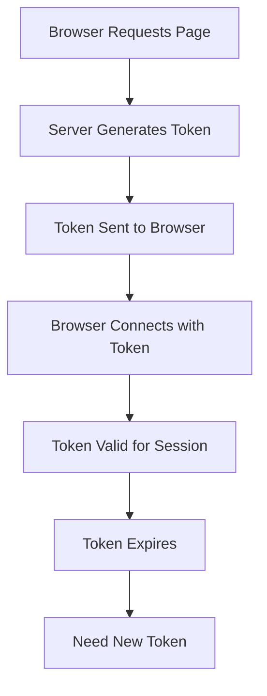

# Lesson 1.2: SignalWire Authentication & Tokens

## 🎯 Learning Goals
- Understand SignalWire's authentication model
- Learn about JWT tokens and their purpose
- Master the token generation flow
- Understand subscriber references

## 🔐 Why Authentication Matters

In WebRTC applications, authentication serves multiple purposes:

1. **Identity**: Know who is making/receiving calls
2. **Security**: Prevent unauthorized access
3. **Billing**: Track usage for accounting
4. **Routing**: Direct calls to the right recipient

## 📋 SignalWire's Authentication Model

### The Three Credentials

```yaml
SIGNALWIRE_SPACE: your-space.signalwire.com
SIGNALWIRE_PROJECT_KEY: PWXXXXXXXXXXXXXXXX
SIGNALWIRE_TOKEN: PTxxxxxxxxxxxxxxxx
```

Think of these as:
- **Space**: Your company's phone system
- **Project Key**: The admin username
- **Token**: The admin password

### Subscriber Model

```
┌──────────────────────────┐
│    SignalWire Space      │
├──────────────────────────┤
│  Subscribers:            │
│  • user1 (our default)   │
│  • alice                 │
│  • bob                   │
│  • support-team-5        │
└──────────────────────────┘
```

Each subscriber:
- Has a unique reference (like a username)
- Gets their own authentication token
- Can make and receive calls
- Has presence (online/offline status)

## 🎫 Understanding JWT Tokens

### What's in a Token?

SignalWire tokens are JWTs (JSON Web Tokens) containing:

```javascript
// Decoded token structure (simplified)
{
  "sub": "user1",           // Subscriber reference
  "iat": 1701234567,        // Issued at timestamp
  "exp": 1701238167,        // Expiration timestamp
  "project": "abc123",      // Your project ID
  "capabilities": [         // What this token can do
    "voice.call",
    "voice.receive"
  ]
}
```

### Token Lifecycle



## 🔄 The Authentication Flow

### Step-by-Step Breakdown

#### 1. Browser Requests Page
```http
GET http://localhost:3000/
```

#### 2. Flask Server Handles Request
```python
@app.route('/')
def index():
    # Server-side token generation
    token, subscriber_id = get_signalwire_token()
    return render_template('index.html', token=token)
```

#### 3. API Call to SignalWire
```python
def get_signalwire_token():
    # This happens server-side with admin credentials
    response = requests.post(
        'https://space.signalwire.com/api/fabric/subscribers/tokens',
        json={'reference': 'user1'},
        auth=(PROJECT_KEY, TOKEN)  # Admin credentials
    )
    return response.json()
```

#### 4. Token in Browser
```javascript
// Token is now in the browser
window.SIGNALWIRE_TOKEN = "eyJ0eXAiOiJKV1QiLCJhbG...";

// Used to authenticate
client = await SignalWire.SignalWire({ 
    token: window.SIGNALWIRE_TOKEN 
});
```

## 🛡️ Security Best Practices

### ✅ DO:
```python
# Generate tokens server-side
def get_token():
    # Admin credentials stay on server
    return api_call_with_admin_creds()
```

### ❌ DON'T:
```javascript
// Never put admin credentials in browser!
// BAD: This exposes your credentials
const token = await generateToken(PROJECT_KEY, TOKEN);
```

## 🔍 Debugging Authentication

### Check Token Generation

In your browser console:
```javascript
// See your token
console.log(window.SIGNALWIRE_TOKEN);

// Decode it (for learning only!)
// In production, tokens should be treated as opaque
const parts = window.SIGNALWIRE_TOKEN.split('.');
const payload = JSON.parse(atob(parts[1]));
console.log('Token payload:', payload);
```

### Common Issues

| Problem | Cause | Solution |
|---------|-------|----------|
| "Invalid token" | Expired or malformed | Generate fresh token |
| "Unauthorized" | Wrong credentials | Check .env file |
| "Connection failed" | Network or token issue | Check console errors |

## 🧪 Hands-On Exercise

### Exercise: Token Inspection

1. Start your Module 1 app
2. Open browser developer tools
3. Go to Network tab
4. Reload the page
5. Find the request to your Flask server
6. Look at the response - you'll see the token in the HTML

### Exercise: Token Expiration

1. Modify `app.py` to log token details:
```python
def get_signalwire_token():
    # ... existing code ...
    data = response.json()
    print(f"Token generated for: user1")
    print(f"Token (first 20 chars): {data.get('token', '')[:20]}...")
    print(f"Subscriber ID: {data.get('subscriber_id', '')}")
    return data.get('token', ''), data.get('subscriber_id', '')
```

2. Restart server and watch the logs

## 💡 Key Takeaways

1. **Tokens are temporary credentials** - They expire and need refreshing
2. **Server generates, client uses** - Keep admin credentials server-side
3. **One token per subscriber** - Each user gets their own
4. **Tokens enable everything** - No token, no calls

## 🎯 Module 1 Lab Preview

Now that you understand authentication, you're ready for the lab where you'll:
- Modify the user reference
- Add token refresh logic
- Implement connection retry
- Add authentication error handling

## ✅ Knowledge Check

1. **Where should admin credentials be stored?**
   - Only on the server, never in the browser

2. **What information does a token contain?**
   - Subscriber identity, expiration, capabilities

3. **Why generate tokens server-side?**
   - To keep admin credentials secure

4. **What happens when a token expires?**
   - Connection fails, need to generate new token

## 🚀 Ready for the Lab?

You now understand:
- ✅ How SignalWire authentication works
- ✅ The token generation flow
- ✅ Security best practices
- ✅ How to debug authentication issues

Continue to [Lab Instructions →](../lab/instructions.md)